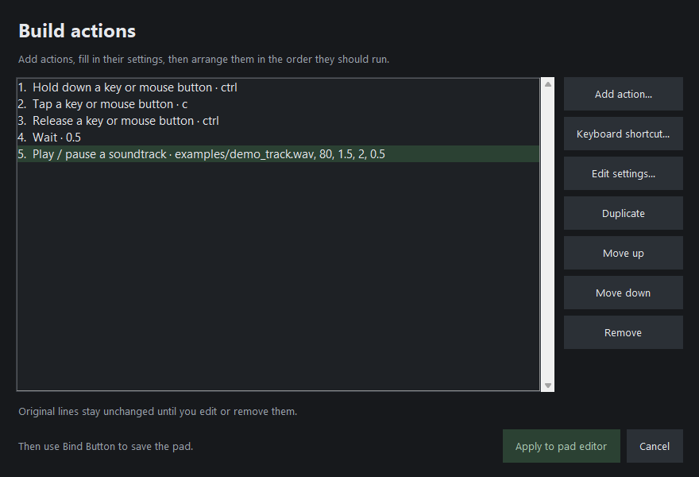
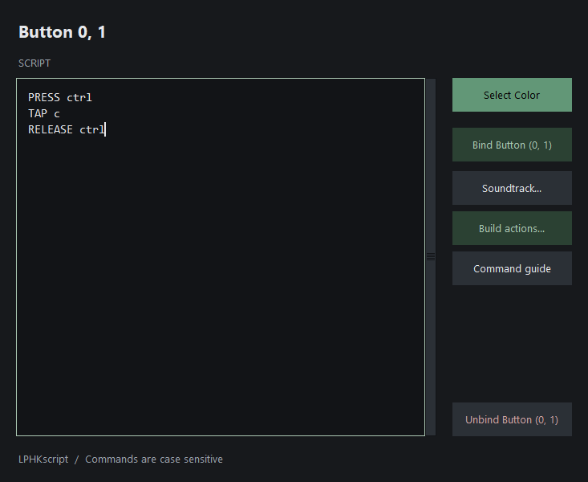
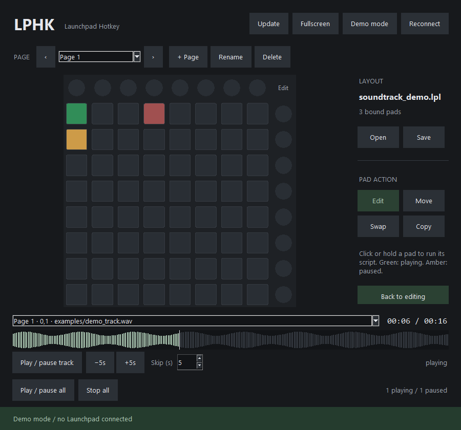

# lphk

lphk lets you use a novation launchpad as a macro keyboard. each pad can run
a script, press a shortcut, control your music, play a sound, or open something.

this is my fork of [nimaid's lphk](https://github.com/nimaid/LPHK). i've kept
the original scripting language and layout formats, added a dark interface,
and worked on windows, linux, and mangowm support. credit for the original
tool goes to **ella jameson (nimaid)**.


the screenshot uses an example layout. there wasn't a launchpad connected when
it was taken.

## getting it running

download the build for your system from this repo's **releases** page, then
extract the whole archive.

- **windows:** open `LPHK.exe`.
- **linux:** open a terminal in the extracted folder and run `./LPHK`.

the release files are named `LPHK-0.7.0-Windows-x86_64.zip` and
`LPHK-0.7.0-Linux-x86_64.tar.gz`. both include python and the app's libraries.
the linux build also bundles the wayland input tools, so you don't need to
install those separately. github's source-code zip needs a development setup.

these builds are for x86_64 windows 10/11 and linux. there aren't macos or arm
builds here. linux builds use ubuntu 22.04 as their glibc baseline; i can't
promise they'll work on every distribution.

you'll still need usb/midi access and the appropriate launchpad driver if your
device needs one. the gui uses x11 or xwayland on linux. file dialogs follow
your desktop's theme.

### cachyos and mangowm

for the prebuilt linux download, run this once from a terminal in your mangowm
session, inside the extracted folder:

```bash
bash install-linux-input.sh
```

then start the app:

```bash
./LPHK
```

the setup script asks for sudo to install the bundled input helper and its
systemd service. it backs up your mangowm config before adding a rule for the
virtual device. it doesn't download python or install application packages.
run the app itself as your normal user.

wayland needs this extra permission step so the helper can send keyboard and
mouse input through `/dev/uinput`. its socket is restricted to your account
with mode `0600`.

use a current mangowm version with `get cursorpos` and `device_rule` support.
lphk talks to mangowm's ipc directly, so `mmsg` isn't required. text entry uses
the virtual keyboard protocol. the wayland backend is intended for mangowm;
other compositors need their own cursor integration.

if your mangowm config lives somewhere else:

```bash
LPHK_MANGO_CONFIG=/path/to/your/config.conf bash install-linux-input.sh
```

you can check the setup with `./LPHK --check-system`. that command doesn't
generate keyboard or mouse input. games, screen locks, pointer grabs, and
desktop bindings can still affect which inputs get through.

## using it

connect your launchpad before opening lphk. if you plug it in afterward, use
**reconnect** or **launchpad > redetect**.

click a pad in **edit** mode, write your script, choose a colour, and press
**bind button**. use **save** to keep the layout.

**move**, **swap**, and **copy** each take two clicks: the source pad, then the
destination. you can also change modes with the original control in the top
right of the grid. new, load, save, and save as are still in the layout menu.
script import/export, validation, colour selection, and unbinding are still
available in the editor.

you can also build the whole script without writing command syntax:

1. open a pad and click **build actions…**.
2. use **add action…**, choose what it should do, and fill in its settings.
3. add more actions, then move them up/down to set their order.
4. use **apply to pad editor**, then **bind button** and save the layout.

every command has a form: keys, mouse actions, text, websites, programs, audio,
delays, pages, labels, repeats, and the special first-line actions. key, page,
and existing-label fields offer dropdowns. files can be browsed; imported
audio is copied into `user_sounds`. fades are entered in seconds.

**keyboard shortcut…** creates the press/tap/release sequence from modifier
checkboxes and a key. existing scripts open as ordered actions. comments and
unrecognized lines stay unchanged unless you edit or remove them. cancel
leaves the original script alone. the text editor is still available.





for example, this sends ctrl+c:

```text
PRESS ctrl
TAP c
RELEASE ctrl
```

this toggles media playback:

```text
TAP play_pause
```

and this holds a key for as long as you hold the launchpad button:

```text
@SIMPLE a
```

the full command list is in the [scripting reference](docs/SCRIPTING.md).
you can read it offline from the help menu too.

## soundtracks and demo mode

you can now try lphk without a launchpad. click **demo mode** or choose it from
the launchpad menu. an empty session loads the included soundtrack example.
click **play pads** to run the pads with your mouse, or **back to editing** to
change their bindings. hold the mouse button for hold-to-press scripts.
play mode runs the assigned scripts on your computer, including normal macros.

for your own soundtrack:

1. open a pad in edit mode and click **soundtrack...**.
2. browse for an audio file, then set its volume, play/resume fade-in,
   pause fade-out, and stop/end fade-out times.
3. apply the settings and bind the pad.
4. switch to play pads, or press the actual launchpad button.

the first press starts the track. the next fades it out and pauses it; another
press resumes from that position, with the fade-in you chose. this uses the same
audio channel rather than replaying the file. the pause fade is separate from the fade used at the end of the track and
when using **stop all**. stopping resets a track; pausing keeps its place.

the toolbar also has one **play / pause all** button: first click starts the
soundtrack pads, the next pauses them, and another resumes them. each track
uses its own fade times. separate pause and resume pads are optional.

playing pads turn green, paused pads turn amber, and the green level follows
the fade. supported launchpads pulse amber while paused; older models show a
steady colour. stopped pads return to their saved colours. the main window
also shows how many tracks are playing or paused.



settings are saved in the pad's script, so existing layout formats still work:

```text
SOUND_TRACK "music/my track.ogg" 80 1500 2000 500
```

the numbers are volume percent, play/resume fade-in milliseconds, stop/end
fade-out milliseconds, and pause fade-out milliseconds. the optional last
number defaults to the stop/end fade for older bindings. the soundtrack dialog
shows all fade times in seconds. use `SOUND_PAUSE` or
`SOUND_RESUME` to control all soundtrack pads from another pad; an optional
millisecond argument overrides the individual fade settings. `SOUND_STOP 1000`
stops all audio with a one-second fade. the original `SOUND` command still plays
ordinary sound effects and can overlap with soundtracks.

browsing copies the file into `user_sounds` without overwriting an existing
file. share that audio folder alongside your layout if you move it to another
computer. wav and ogg are the safest formats; other formats depend on the
bundled sdl_mixer decoder. tracks are decoded into memory, so several large
files can use a lot of ram. the demo tone was generated for this project.

## monitor, pages, and fullscreen

the small monitor below the launchpad shows the selected track and its elapsed
time / total length. its progress bar is a waveform from the actual audio.
the played part turns green, or amber while paused. click anywhere on it to
seek. the track selector includes tracks playing on other pages too.

use the back and forward buttons to skip by the number in **skip (s)**.
you can change that number; it is remembered next time. play / pause track
controls the selected track, while play / pause all controls every active track.

use **+ page** to add another set of pads. the selector and arrow buttons
switch pages; rename and delete are next to them. audio keeps playing when
you switch pages, and the same pad position on another page has its own track.
save the layout to keep all its pages. older single-page layouts still open;
older app versions can only see the active page of a new multi-page layout.

for page-switching pads, use `PAGE_NEXT`, `PAGE_PREV`, or `PAGE "page name"`.
`SOUND_SKIP -5` skips active soundtracks back five seconds; `SOUND_SEEK 30`
jumps to thirty seconds. add pad coordinates to target one track, for example
`SOUND_SKIP 5 0 1` for pad 0,1 on that page.

**help > command guide** lists every available command with an explanation
and example. you can search it, copy examples, or insert one from the editor.

click **fullscreen** or press **f11** to toggle fullscreen. **esc** leaves it.
the launchpad scales with the window, and the monitor stays below it.

## updates

click **update**, then **check for updates**. a newer published release can be
downloaded, checked against its sha-256 checksum, and installed after you
confirm. the app asks to save an unsaved layout before closing and restarting.
your layouts, scripts, sounds, pages, and settings are kept. the previous app
files go into `_rollback` beside the app. keep the app in a writable folder.
source checkouts should be updated with git instead.

## your layouts and scripts

layouts use `.lpl`, and individual scripts use `.lps`. the older `.LPHKlayout`
and `.LPHKscript` formats can still be imported.

by default, your files go in `user_layouts`, `user_scripts`, and `user_sounds`
beside the app. keep it in a writable folder. **help > user folder** opens the
location it's actually using.

you can set `LPHK_USER_PATH` to use a different folder. existing `USERPATH`
files also work. examples are copied on first launch without overwriting your
existing examples. a layout at `user_layouts/startup.lpl` loads when you connect.

if you're moving layouts between windows and linux, check any program paths
or os-specific shortcuts in your scripts.

## launchpads

the existing connectors cover classic/mini/s, mkii, mini mk3, launchpad x,
and launchpad pro. pro support still has the original beta limitations; follow
the connection prompts. this fork doesn't add support for unrelated midi
controllers.

## building it yourself

use python 3.11 or 3.12. on windows, run `SETUP.bat`, then `RUN.bat`.
on linux/x11, run `bash SETUP.sh`, then `bash RUN.bash`.

for a cachyos/mangowm source checkout, use `bash SETUP_CACHYOS.sh`. that script
is for development: it uses pacman and downloads python and dependencies.
the prebuilt release's setup script above doesn't do that.

to make a release archive from your development environment:

```bash
python -m pip install -r requirements.txt pyinstaller==6.22.3
python build.py
python release_tools/package_release.py
```

on linux, build the bundled helpers first with
`python release_tools/build_linux_helpers.py`. the build-machine packages are
listed in `.github/workflows/release.yml`. build on the os you're targeting.

### building through github

open **actions > build downloadable apps** and run the workflow to get
windows and linux artifacts. pushing a tag that matches `VERSION`, such as
`v0.7.0`, also creates a draft release after both builds finish.

review and publish that draft to make it available through the app's update
button. keep the generated app archives and `.sha256` files attached.
the updater uses this public repo: [andreonaise/lphk](https://github.com/andreonaise/lphk).
actions artifacts and draft releases aren't treated as app updates.

## what has been tested

the windows gui, packaged startup/shutdown, and 92 automated tests have passed.
the gui checks use a fake launchpad and cover the pad modes, script editing,
colour selection, import/export, layout save/load, help, and disconnection.

real launchpad hardware and live mangowm/wayland input still need testing.
a passing build on a linux runner doesn't confirm those work on a real desktop.

if something breaks, include your os, desktop/session type, launchpad model,
and the relevant part of `LPHK.log` from the user folder when reporting it.

## android preview

there is also an android app for touchscreen pads and editing a physical
launchpad mini. it includes soundtrack playback, fades, pages, a waveform
monitor, and desktop layout import/export. keyboard/mouse scripts can be
edited for desktop use, but won't execute as desktop macros on android.

see [the android readme](android/README.md) for installation and usb setup.
**actions > build android apk** builds its apk separately from the desktop apps.
this first android build still needs testing on a phone and a real launchpad.

## credits

the original lphk was made by **ella jameson (nimaid)**. this is a fork with
changes to the interface, platform support, input handling, and packaging.
it isn't an official novation product or an upstream lphk release.

the original [gpl-3.0 license](LICENSE) is kept. [upstream.md](UPSTREAM.md)
records where the code came from, and [third_party.md](THIRD_PARTY.md) lists the
bundled components. please keep the notices and corresponding source available
when redistributing it.
