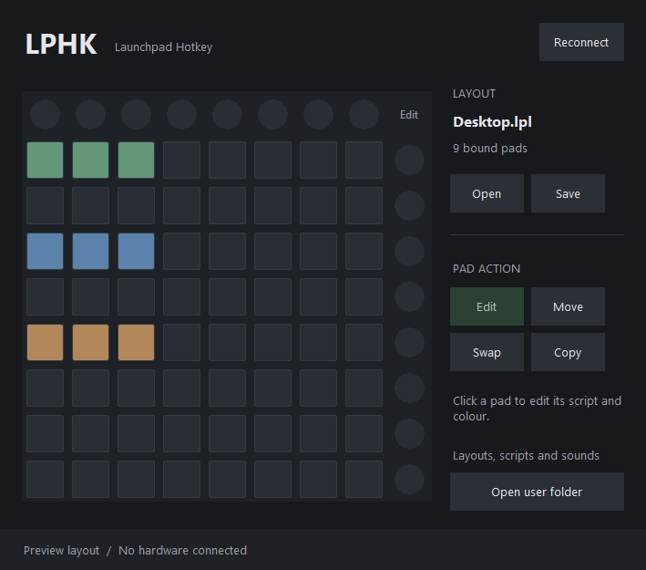

# LPHK

A macro editor for Novation Launchpads, with a dark desktop interface.

Assign scripts and colours to your pads. Use them for keyboard shortcuts,
media controls, mouse actions, sound effects, or opening files and websites.



*Example layout shown without a connected device.*

This is a modified edition of [nimaid/LPHK](https://github.com/nimaid/LPHK).
The original scripting language, layout format, and pad actions are retained.

## Download

Open **Releases** on this repository and download the archive for your system.

| System | Release archive | Getting started |
| --- | --- | --- |
| Windows 10/11, x86_64 | `LPHK-0.4.0-Windows-x86_64.zip` | Extract the entire folder and open `LPHK.exe`. |
| Linux, x86_64 | `LPHK-0.4.0-Linux-x86_64.tar.gz` | Extract the entire folder and run `./LPHK`. |

Prebuilt releases include Python and the application's libraries. The Linux
archive also includes the Wayland input tools. You do not need pip, a Python
installation, conda, or a compiler to use a prebuilt release. Downloading
GitHub's **Source code** archive is for development, not a ready-to-run app.

You still need a working graphical desktop, USB/MIDI access, and the appropriate
Launchpad driver where required. The Linux GUI needs X11 or your Wayland
desktop's XWayland support. Native file dialogs follow your desktop's theme.

Only x86_64 Windows and Linux builds are provided. macOS and ARM builds are not
part of this release configuration. Linux builds use Ubuntu 22.04 as the glibc
baseline; CachyOS is the intended MangoWM target, not a promise of support for
every Linux distribution.

## CachyOS / MangoWM

For a **prebuilt Linux release**, open a terminal inside the extracted folder
from your MangoWM session:

```bash
bash install-linux-input.sh
./LPHK
```

Run the setup script once, as your normal user. It installs the **bundled**
virtual-input helper using sudo, creates a per-user systemd service, backs up
your MangoWM configuration, and adds a rule for the virtual device. It does not
download Python or install application packages. LPHK itself runs without sudo.

The helper needs `/dev/uinput` access to send keys and mouse actions to native
Wayland apps. That permission step cannot be removed by bundling dependencies.
The helper socket is restricted to your account with mode `0600`.

MangoWM must support `get cursorpos` and the current `device_rule` configuration
syntax. Cursor queries use MangoWM's IPC directly; no separate `mmsg` install is
needed. Unicode text uses the virtual keyboard protocol. Other Wayland
compositors need their own cursor integration.

If you use a custom MangoWM config:

```bash
LPHK_MANGO_CONFIG=/path/to/your/config.conf bash install-linux-input.sh
```

For diagnostics, run `./LPHK --check-system`. This does not type or move the
mouse. Keyboard grabs, game confinement, desktop shortcuts, and screen locks
can still limit what applications accept.

## Use

1. Connect your Launchpad before starting the app.
2. LPHK detects it on startup. Use **Reconnect** or **Launchpad > Redetect** if
   you connect it later.
3. In **Edit** mode, click a pad, enter a script, choose its colour, and select
   **Bind Button**.
4. Save your layout from the **Layout** menu or **Save** button.

**Move**, **Swap**, and **Copy** work by selecting a source pad and then a
destination. The original mode control in the grid's upper-right corner still
works. The Layout menu retains New, Load, Save, and Save As. The script editor
retains import, export, validation, colour selection, and unbinding.


### Example scripts

Copy the current selection:

```text
PRESS ctrl
TAP c
RELEASE ctrl
```

Toggle media playback:

```text
TAP play_pause
```

Hold a key while the Launchpad button is held:

```text
@SIMPLE a
```

See the [LPHKscript reference](docs/SCRIPTING.md) for the full command list.
The README and scripting reference are also available offline from **Help**.

### Layouts and files

Layouts use `.lpl`; individual scripts use `.lps`. Legacy `.LPHKlayout` and
`.LPHKscript` imports remain available. By default, files are kept in
`user_layouts`, `user_scripts`, and `user_sounds` beside the app. Keep the app in
a writable folder. **Help > User Folder** opens the active location.

Set `LPHK_USER_PATH` to use another data directory. Existing `USERPATH` files
are also supported. Bundled examples are copied on first launch without
overwriting existing examples. `user_layouts/startup.lpl` loads on connection.
Windows program paths and platform-specific shortcuts in your own macros may
need changing when moving a layout to Linux.

## Devices

The existing connectors are retained for Launchpad Classic/Mini/S, MkII,
Mini Mk3, Launchpad X, and Launchpad Pro. Pro support retains upstream's beta
limitations; see the scripting reference and device connection prompts.
This edition does not add support for unrelated MIDI controllers.

## Build from source

Development requires Python 3.11 or 3.12. These steps are not needed for a
prebuilt download.

On Windows, run `SETUP.bat`, then `RUN.bat`. On Linux/X11, run `bash SETUP.sh`,
then `bash RUN.bash`. CachyOS/MangoWM source users can run
`bash SETUP_CACHYOS.sh`; that developer setup uses pacman and downloads Python
and dependencies, unlike the prebuilt-release setup above.

To build a native archive, install PyInstaller in your development environment:

```bash
python -m pip install -r requirements.txt pyinstaller==6.22.3
python build.py
python release_tools/package_release.py
```

On Linux, first build the bundled tools with
`python release_tools/build_linux_helpers.py`. Build-machine packages are listed
in `.github/workflows/release.yml`. Build on the target operating system; the
Windows build does not create a Linux binary.

## GitHub releases

The **Build downloadable apps** workflow builds Windows and Linux archives and
checks the packaged GUI. Run it manually to get downloadable Actions artifacts,
or push a tag matching `VERSION`, for example `v0.4.0`, to create a draft GitHub
release with both app archives, source, and SHA-256 checksums. Review the draft
and publish it when the builds are ready. The source repository does not contain
generated binaries or a local virtual environment.

## Testing and status

Automated checks cover backend selection, input mappings, error handling,
configuration backups, bundled-tool lookup, and windowed logging. GUI checks
exercise Edit/Move/Swap/Copy, the original corner mode control, colour selection,
script import/export, layout save/load, Help, and disconnection with a fake
Launchpad. Packaged startup/shutdown is checked separately.

Windows GUI and packaged-app checks have been run during this edition's
development. Real Launchpad hardware and MangoWM/Wayland input still require
on-device testing. A successful headless Linux build does not replace hardware
testing. When reporting a problem, include your OS, desktop/session type,
Launchpad model, and the relevant part of `LPHK.log` from the user folder.

## Credits and license

LPHK was created by **Ella Jameson (nimaid)**. This edition updates the interface,
platform handling, Wayland input, and release packaging. It is a fork, not an
official Novation product or an upstream release.

LPHK's original [GPL-3.0 license](LICENSE) is retained. See [UPSTREAM.md](UPSTREAM.md)
for provenance and [THIRD_PARTY.md](THIRD_PARTY.md) for bundled components. Keep
the license, notices, and corresponding source available when redistributing.
